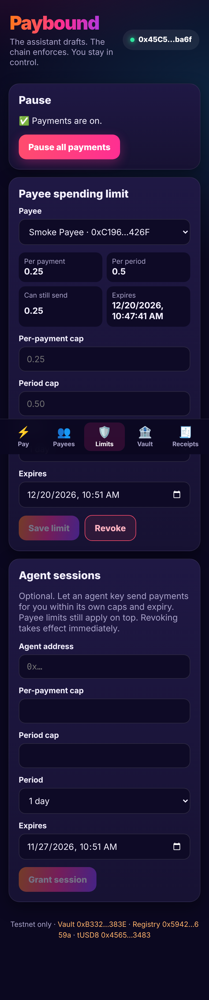
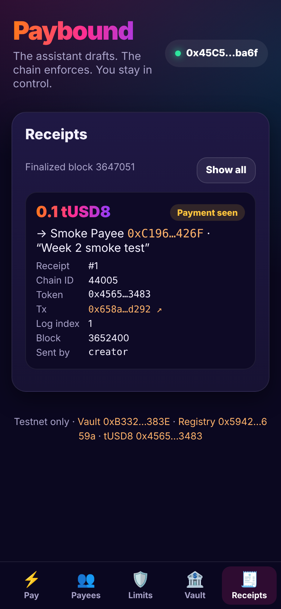

# Paybound

**An AI payout assistant for creators on QDay Aevum.** Tell it who to pay in plain English; it drafts the payment. tUSD8 only ever goes to payees you've confirmed, inside on-chain spending limits you can revoke at any time. The assistant drafts, the chain enforces, and you stay in control.

> Built for **QDay Aevum Builder Challenge #1**. **Track: Confirmation of Payee** (with an AI drafting layer from the Native AI Assistants track). **Testnet only. Test tokens only.**

| | |
|---|---|
| Live demo | https://paybound-qday.netlify.app (open it in your wallet's in-app browser on mobile) |
| Network | QDay Aevum Testnet, chain ID `44005` (`0xABE5`) |
| RPC / Explorer | `https://rpc-test.qday.info` / https://explorer-test.qday.info |
| Payment token | tUSD8 `0x456569838f1d43009A91ebA4263147Afd7233483` (6 decimals) |
| PayeeRegistry | [`0x5942f4Ce67411cF4AE1d794535Ebdf9374E7659a`](https://explorer-test.qday.info/address/0x5942f4Ce67411cF4AE1d794535Ebdf9374E7659a) |
| PayboundVault | [`0xB332eea4bBb9CA78371C63BccB0B5b50C213383E`](https://explorer-test.qday.info/address/0xB332eea4bBb9CA78371C63BccB0B5b50C213383E) |

## Deployment (Aevum Testnet 44005)
Deployed 17 Nov 2026 at block 3390615 by `0x45C5B3c807Da0f46eD82539924a5EFe0A010ba6f` (a testnet-only deployer, also the guardian for now). Full record: [`deployments/aevum-44005.json`](deployments/aevum-44005.json).

| Contract | Address | Deploy tx |
|---|---|---|
| PayeeRegistry | [`0x5942f4Ce67411cF4AE1d794535Ebdf9374E7659a`](https://explorer-test.qday.info/address/0x5942f4Ce67411cF4AE1d794535Ebdf9374E7659a) | [`0x80299e42…3ec5`](https://explorer-test.qday.info/tx/0x80299e42a036713c9e612a73aded64d42b0845ef94e8eb5ff6dc1fcf6a803ec5) |
| PayboundVault | [`0xB332eea4bBb9CA78371C63BccB0B5b50C213383E`](https://explorer-test.qday.info/address/0xB332eea4bBb9CA78371C63BccB0B5b50C213383E) | [`0x2b171f43…b13a`](https://explorer-test.qday.info/tx/0x2b171f436649abced5c8863f60f381db7d7d35c796438e72f8bf59f3af15b13a) |
| tUSD8 (official) | [`0x456569838f1d43009A91ebA4263147Afd7233483`](https://explorer-test.qday.info/address/0x456569838f1d43009A91ebA4263147Afd7233483) | n/a |

Constructor: `PayboundVault(tUSD8, PayeeRegistry, guardian)`. Compiler: solc 0.8.24, optimizer 200 runs, evmVersion `paris`. The on-chain runtime bytecode matches a local `forge build` byte for byte.

**Source verification:** submitted to the explorer on 17 Nov 2026, but it returned `Fail - Unable to verify`. The explorer's verifier appears not to be set up yet: it lists no Solidity compiler versions, and no contract on it is verified, not even the official tUSD8. Re-run the `forge verify-contract` commands below once that's fixed.

## Web app (week 2)
Mobile-first, bold UI with five tabs:

| Tab | What it does |
|---|---|
| ⚡ **Pay** | Pick a confirmed payee, enter an amount, and see a live on-chain `previewPayment()` result in plain English (for example "Amount is above this payee's per-payment cap") **before** signing. Every payment records a `ref` hash of the approved draft. |
| 👥 **Payees** | Add a payee as Pending, then **confirm by re-entering the full address**, after an optional 0–168h waiting period. Remove payees. **Address-poisoning warning** when a new address shares its first and last 4 hex chars with an existing payee, a past payee, or a recent counterparty. |
| 🛡️ **Limits** | Per-payment cap, period cap (1h / 1d / 1w / 30d), and expiry per payee; revoke. Agent sessions: grant and revoke with their own caps and expiry. Pause or unpause all payments. |
| 🏦 **Vault** | Deposit (exact-amount `approve` → `deposit`, never unlimited) and withdraw. Balances in tUSD8 and tQDAY. |
| 🧾 **Receipts** | Every `PaymentExecuted` event shows chain ID, token, tx hash (explorer link), log index, block, payee, amount, and memo. Logs are fetched in ≤1000-block pages from the deploy block, cached locally, and deduped by `txHash:logIndex`. **Payment seen** means it's in the `latest` chain; **Payment final** means it's at or below the node's `finalized` block. |

Amounts are `bigint` end to end; decimals are pinned to 6 in `web/src/contracts.ts`. The app refuses any chain other than 44005, simulates every transaction first so reverts show a readable reason, and maps every contract error and `Blocker` code to plain English.

| Pay (blocked over cap) | Payees (poisoning warning) | Limits | Receipts |
|---|---|---|---|
|  |  |  |  |

## End-to-end smoke test (Aevum 44005, 20 Nov 2026)
`scripts/smoke.sh` (uses gitignored `.env` / `.env.payee`):

| Step | Tx |
|---|---|
| approve 0.5 tUSD8 | [0xe0a36f…9507](https://explorer-test.qday.info/tx/0xe0a36fbd11b59c629c04a08e8e539a645782244cca3e1ac357f64169ce159507) |
| deposit 0.5 | [0x41135c…1c90](https://explorer-test.qday.info/tx/0x41135c4cc79be9ac969ad360954ec94b73b629b6e8fbf484814e7bbbc1201c90) |
| addPayee "Smoke Payee" | [0xa092b1…4799](https://explorer-test.qday.info/tx/0xa092b1f43c1408d0025db101e77d1c14149dbbefa5a8777b7817fe02c0694799) |
| confirmPayee (re-entered address) | [0x7b8f3d…7fd7](https://explorer-test.qday.info/tx/0x7b8f3db920958237a9edb15ec99098b9127833a24a7fcba1eea07828ffd57fd7) |
| setPayeeLimit 0.25/tx, 0.5/day, 30d | [0x91723f…d498](https://explorer-test.qday.info/tx/0x91723f734b9c514383b0fa46d12bc534c1675b850d9a3fb741a356c33bfcd498) |
| previewPayment 0.30 → `OverPayeeTxCap` (7); 0.10 → `None` (0) | eth_call |
| pay 0.1 tUSD8, memo "Week 2 smoke test" → receipt #1 | [0x658a79…d292](https://explorer-test.qday.info/tx/0x658a79fc542f4afb1d3de2533a9e9629836b19fff46143487de0e503e1c2d292) |

Result: the payee received 0.1 tUSD8, the vault balance is 0.4, 0.25 is left under the cap, and the receipt shows in the web app.

## The problem
<!-- TODO: 1 paragraph. Creators pay collaborators by handle, not by raw address; lookalike / poisoned addresses and unlimited approvals cause losses; AI agents that can move money need hard limits. -->

## How it works
1. **Fund a bounded vault:** deposit tUSD8 into `PayboundVault`. You can always withdraw, even while paused.
2. **Confirm payees:** add a payee (label + address) to `PayeeRegistry`, then confirm by re-entering the full address, with an optional cooling-off delay. Unconfirmed payees can't be paid.
3. **Set the leash:** per-payee per-payment cap, period cap (e.g. daily or weekly), and expiry.
4. **Ask, don't auto-send:** "Pay Ada 25 tUSD8 for the November thread" returns a draft that shows the matched payee, amount, remaining cap, and any blockers (via `previewPayment`).
5. **Sign:** you sign `pay()` in your wallet. The receipt event links back to the draft (`ref`) and to the explorer.
6. **Revoke anytime:** revoke a payee limit or an agent session, or pause your vault.

Optional: grant an agent key a **scoped session** with its own per-payment and period caps and an expiry. Payee limits still apply on top, and revoking takes effect immediately.

## Architecture
See [docs/ARCHITECTURE.md](docs/ARCHITECTURE.md).

```
AI draft layer (assistant/)  ──drafts only──▶  Web app (web/)  ──creator-signed txs──▶  PayboundVault ──▶ tUSD8
                                                     │                                       │
                                                     └──────────confirm / look up──────▶ PayeeRegistry
```

## Repo layout
| Path | What |
|---|---|
| `contracts/` | Foundry project: `PayeeRegistry.sol`, `PayboundVault.sol`, tests, deploy script |
| `web/` | Vite + React + wagmi/viem frontend (hard-locked to chain 44005) |
| `assistant/` | Propose-only draft service (no keys); guard rails and prompt-injection tests |
| `scripts/` | Helpers (ABI export) |
| `docs/` | Architecture, demo script, limits and roadmap |

## Quick start
### Prerequisites
- Foundry, Node 22.6+ (Node 24 recommended)
- A wallet on Aevum 44005 with tQDAY for gas and tUSD8 from https://faucet.qday.info

### Contracts
```bash
git clone --recursive <repo> && cd paybound/contracts
forge build
forge test                       # unit + fuzz tests
FORK=1 forge test --match-contract AevumFork   # happy path against the real tUSD8 on an Aevum fork
```

### Deploy (Aevum testnet)
```bash
cp .env.example .env             # fill DEPLOYER_PRIVATE_KEY (a throwaway TESTNET key)
cd contracts && set -a && . ../.env && set +a
forge script script/Deploy.s.sol --rpc-url aevum --broadcast --legacy
```
Verify on the explorer (Blockscout):
```bash
forge verify-contract <REGISTRY> src/PayeeRegistry.sol:PayeeRegistry --chain-id 44005 \
  --verifier blockscout --verifier-url https://explorer-test.qday.info/api/
forge verify-contract <VAULT> src/PayboundVault.sol:PayboundVault --chain-id 44005 \
  --verifier blockscout --verifier-url https://explorer-test.qday.info/api/ \
  --constructor-args $(cast abi-encode "c(address,address,address)" 0x456569838f1d43009A91ebA4263147Afd7233483 <REGISTRY> <GUARDIAN>)
```

### Web
```bash
node scripts/export-abi.mjs
cd web && cp .env.example .env   # set VITE_VAULT_ADDRESS / VITE_REGISTRY_ADDRESS
npm install && npm run dev
```

### Assistant
```bash
cd assistant && npm test && npm start   # POST http://localhost:8787/draft
```

## Safety controls
| Control | Where |
|---|---|
| Propose-only assistant, every payment wallet-signed | `assistant/`, `web/` |
| Confirmed payees only (re-enter address, optional delay) | `PayeeRegistry` |
| Per-payment and period caps, expiry | `PayboundVault.setPayeeLimit` |
| Scoped, expiring, revocable agent sessions | `PayboundVault.grantSession` / `revokeSession` |
| Creator pause and guardian emergency pause (guardian can't move funds) | `PayboundVault` |
| Withdrawals always available | `PayboundVault.withdraw` |
| Lookalike / poisoned address warnings | `assistant/src/lookalike.ts` |
| Prompt-injection guard rails (raw addresses never used as destination) | `assistant/src/draft.ts` |
| On-chain receipts (`PaymentExecuted` with `ref`) | `PayboundVault` |

## Security notes
- Testnet only. No private keys in git: `.env` is gitignored and `.env.example` is blank.
- Payee labels are stored on-chain and are public.
- Not audited.

## Limits and roadmap
See [docs/LIMITS-AND-ROADMAP.md](docs/LIMITS-AND-ROADMAP.md).

## License
MIT
